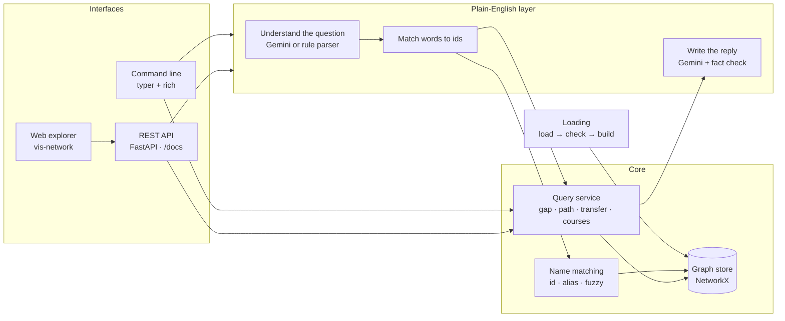
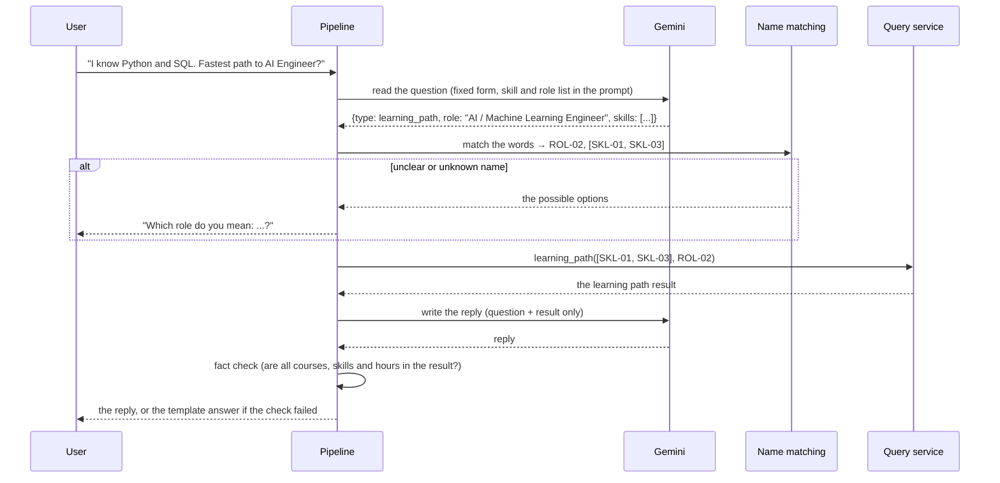

# Technical architecture

This document explains how the code is organised, how each query works step by step, and how a plain-English question flows through the system. If you only want to run the project, the README is enough.

## The layers

There are four layers, and each one only talks to the layer below it:

- **Loading** reads the JSON file, checks it, and builds the graph.
- **The core** holds the graph and the queries: gap analysis, learning path, transferability and courses for a skill.
- **The plain-English layer** turns a question into one of those queries and writes the reply.
- **The interfaces** are the command line, the REST API and the web explorer. They contain no query logic. They all call the same query service, so they always give the same answers.

Two rules keep this clean. The plain-English layer never reads the graph directly; it goes through the query service. And the query service only knows the graph store interface, not NetworkX. That is what makes swapping in Neo4j a contained change.

## What each module does

| Module | What it does |
|---|---|
| `models.py` | Describes the dataset as it really is. Fields the README promises but the data doesn't have are optional, and extra fields are kept. |
| `ingest/loader.py` | Reads the JSON, smooths over differences from the README, and decides if each prerequisite is required or recommended by reading its note. |
| `ingest/validate.py` | Checks the graph: broken links, duplicate ids, prerequisite loops, odd difficulty orders, skills with no course, differences from the README. Errors stop loading. Everything else goes in the report. |
| `graph/schema.py` | The node and relationship names (the same names Neo4j would use). |
| `graph/store.py` | The graph store interface and its NetworkX version. It keeps indexes by relationship type, so looking up a skill's prerequisites doesn't scan every edge. |
| `graph/neo4j_export.py` | Writes a Cypher script that loads the same graph into Neo4j. It is safe to run twice. |
| `services/resolver.py` | Turns a name into an id. It tries the exact id first, then the exact name or a known alias, then a fuzzy match for typos. A fuzzy match is only accepted when it is clearly better than the next best one. Otherwise it returns the options instead of guessing. |
| `services/prerequisites.py` | Finds every prerequisite a learner still needs, puts skills in stages, and counts how many later skills each one unlocks. |
| `services/course_plan.py` | Ranks courses for each skill, picks the set of courses with the fewest hours, and orders the courses. |
| `services/queries.py` | The query service. Role requirements, gap analysis, learning path, transferability, courses for a skill. |
| `services/results.py` | The result types. The command line, the API and the plain-English layer all share them. |
| `render.py` | Turns each result into readable text. Used by the command line and as the template answer. |
| `nl/schema.py` | The fixed form the LLM fills in when it reads a question. |
| `nl/prompts.py` | The instructions given to Gemini for reading questions and writing replies. |
| `nl/llm.py` | The Gemini client, the local reply cache, and the settings. |
| `nl/rules.py` | The rule-based parser, used without an API key and as the baseline. |
| `nl/pipeline.py` | Runs the four steps for a question and records a trace of each step. |
| `nl/grounding.py` | The fact check: every course, skill and number in a reply must be in the query result. |
| `nl/evaluation.py` | Scores the question understanding on the test questions in `eval/`. |

## How the queries work

### Gap analysis

First, the missing skills are simply the role's required skills minus the ones the learner has.

Then I look one step further. Some missing skills need a prerequisite the role doesn't list. For example, an AI Engineer needs Machine Learning, and Machine Learning needs Statistical Analysis, but the role doesn't mention statistics. I add these too and mark them as "needed before Machine Learning".

Each of these skills gets a priority score from 0 to 100, built from four parts:

- **Unlocks (35%):** how much of the learner's remaining path depends on this skill.
- **Demand (25%):** how many roles need this skill.
- **National priority (20%):** whether SDFE 2025 flags it as a priority skill.
- **Readiness (20%):** how many of its own prerequisites the learner already has.

60 and above is High, 40 and above is Medium, and the rest is Low. Each skill also gets up to three suggested courses. A course ranks higher when it also covers the learner's other missing skills, then when its level fits, then when it is SkillsFuture-funded, and then when it is shorter.

### Learning path

This runs in three steps.

1. **Find everything to learn.** Start from the missing skills and follow their required prerequisites backwards until you reach skills the learner already has. In thorough mode, the recommended prerequisites are followed too.
2. **Put it in order.** A skill's stage is the length of the longest prerequisite chain that leads to it. Skills with nothing to wait for are stage 1. A skill that needs a stage 1 skill is stage 2, and so on. Skills in the same stage don't depend on each other, so they can be learned together. Inside a stage, higher priority comes first.
3. **Pick the courses.**
   - A course is only considered if the learner can follow everything it teaches. That means each skill it teaches must have its prerequisites known, on the path, or taught in the same course.
   - Out of those courses, it picks the set that covers every skill in the fewest hours. With up to 18 courses it tries every combination, so the result is the true minimum. With more, it picks the best value course one at a time, which is fast and close to the minimum.
   - The chosen courses are put in order, so a course always comes after the courses that teach its prerequisites. The result gives the total hours, and the hours if you take same-stage courses at the same time.

Each question only looks at the part of the graph around one role, so this stays fast even on a much bigger graph. The only expensive part is trying every course combination, which is why it is capped at 18.

### Transferability (economy A to economy B)

For each skill tagged with economy A, the score combines:

- **Direct demand (40%):** how many roles in economy B need it.
- **Framework rating (30%):** the transferability rating in the data (High, Medium or Low).
- **Breadth (20%):** how many different sectors need it.
- **Links (10%):** whether it sits in a B-economy track, or is a prerequisite of a B-economy skill.

Every skill in the result lists this evidence. When no role in B needs any skill from A, which is the case for Digital to Green in this data, the result says so in a note.

## How a plain-English question flows

The rules behind this design:

- **The LLM only writes down words, never ids.** Matching words to real things is done by code, so a name that doesn't exist or is unclear becomes a question back to the user.
- **The LLM only sees the query result when it writes the reply.** It is told to use only those facts, and the fact check makes sure it did.
- **Nothing fails hard.** If reading the question fails or is refused, the rule parser takes over. If writing the reply fails, is refused, or fails the fact check, the template answer is used. Without an API key, everything runs offline.
- **Every answer comes with a trace.** It shows which parser was used, the model, whether the reply came from the cache, the token counts, the time for each step, and any fact-check problems. You can see it with `--trace` on the command line.

### How Gemini is called

This is all in `nl/llm.py`, using Google's official `google-genai` library.

- **Model:** `gemini-3.8-flash` by default. You can change it with `SKILLGRAPH_LLM_MODEL`.
- **Two ways to connect:** the Gemini API with an API key, or Vertex AI with a service-account file. The request is the same. The code only uses the key or file you configure. It never picks up other Google credentials that happen to be on the machine.
- **Reading questions:** Gemini must return JSON that matches a fixed schema, with every field present. Thinking is set to low, because this is a simple task.
- **Writing replies:** thinking is set to medium.
- **Refusals:** if Google blocks the request or the reply for safety reasons, this is treated as a refusal, and the template answer is used. Gemini's internal thinking text is never shown as the answer.
- **Caching:** the system prompt is the same on every call, so Gemini can cache it. I also keep a local cache of replies on disk. Asking the same question again costs nothing, and demos are repeatable.
- **Errors:** every API or network error becomes one error type with a clear message, for example "key rejected" or "quota reached". A timed-out call is retried once. Calls rejected with 429 or 5xx are retried by the library.

## When things go wrong

| Situation | Command line | API | Plain-English question |
|---|---|---|---|
| Unknown name | Red message with "did you mean", exit code 1 | 422 with the closest options | "I couldn't find..." with the closest matches |
| Unclear name | Lists the options, exit code 1 | 422 with the options | Asks which one you mean |
| Unknown id or economy | Exit code 1 | 404 or 422 | Asks you to clarify |
| Broken dataset | Exit code 2, listing every error | The server doesn't start, and lists every error | Not applicable |
| Gemini not available | Not applicable | Not applicable | Rule parser or template answer, noted in the trace |

## Testing

`pytest` runs 110 tests in about one second, with no internet:

- **Loading:** each check is tested on a copy of the real file with one thing broken.
- **Queries:** for every role and every sample learner, the tests check that no skill comes before its prerequisite and that every missing skill gets covered. The course plans are compared with every possible combination to prove they use the fewest hours.
- **Plain-English layer:** a fake LLM covers the normal case, a reply that names a course that doesn't exist, a failed parse, a refusal, and a made-up role. A fake HTTP server checks the exact request sent to Gemini (model, key, instructions, JSON schema, thinking level). Other tests check that thinking text is dropped, blocked replies become refusals, timeouts are retried, and Vertex only uses the service-account file it is given.
- **API:** every endpoint, plus the error responses.
