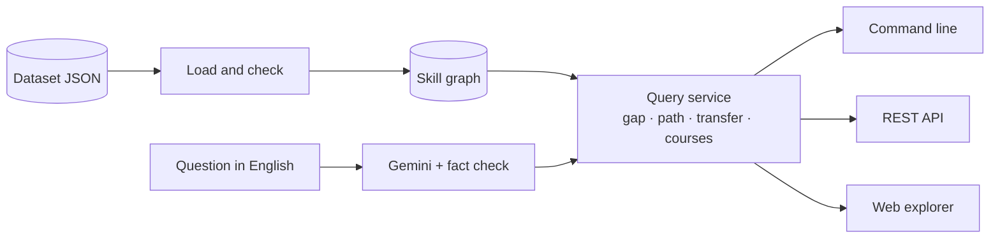
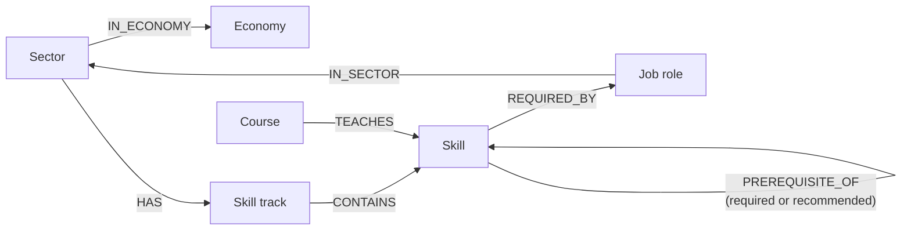
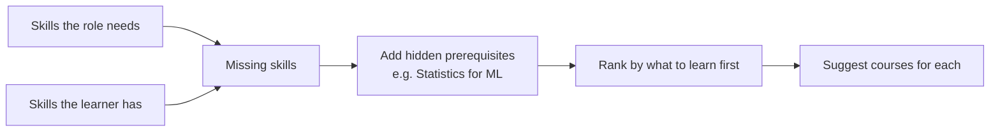
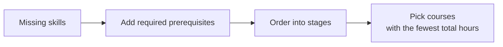
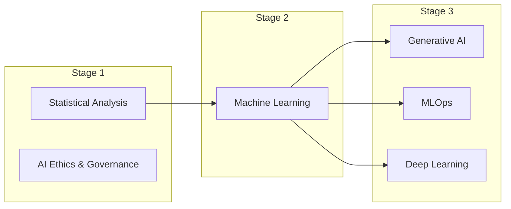
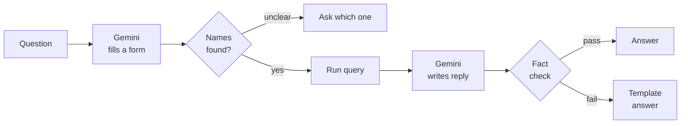

# Design document — Mini Skill & Competency Graph

## Overview

The dataset is loaded, checked, and turned into a graph. One query service answers every question. The command line, the REST API, the web explorer and the plain-English layer all call that same service.

## (a) Graph schema

- **Built around the questions.** Every question is a walk along these links. For example, "what does a Data Scientist need" goes from the role to its skills.
- **Economy is a node.** So "Digital skills useful in Green" is a normal graph walk, not a text filter.
- **Prerequisites are required or recommended.** I read each note in the data. "X is prerequisite for Y" is required (24 links). "X helps Y" is only recommended (6 links). Required ones are added to a path. Recommended ones only change the order.
- **Neo4j-ready.** The names match the brief, and `skillgraph export-cypher` loads the same graph into Neo4j.
- **The data is checked first.** Broken links, duplicate ids and prerequisite loops stop the load. Gaps like skills without a course are reported in `docs/data_quality_report.md`.

## How each part works

### Gap analysis

A skill ranks higher when it unlocks other missing skills, many roles need it, it is a national priority, and the learner is ready for it. Every skill shows its reasons.

Example: Priya wants to be an AI Engineer. Machine Learning ranks first, because it unlocks three of her other missing skills.

### Learning path

Skills in the same stage don't depend on each other, so they can be learned together. Priya's path:

The course plan is the set of courses that covers every skill in the fewest hours, using only courses she is ready for: 172 hours, or 100 if same-stage courses run in parallel.

### Transferable skills between economies

For each Digital skill, the score combines how many Green roles need it, its transferability rating in the data, how many sectors use it, and its links to Green skills. Each skill in the answer lists this evidence.

### Answering questions in English

- **Gemini handles the language, the graph gives the facts.** Gemini never looks up ids or invents numbers.
- **Unclear names get a question back.** "Data analyst" matches three roles, so the system asks which one.
- **It always answers.** Without an API key, a rule-based parser reads the question and a template writes the reply.

Tested on 32 development questions and 12 new ones I never tuned on:

| Parser | Development (32) | Held-out (12) |
|---|--:|--:|
| Rule-based (offline) | 100% | 50% |
| Gemini (`gemini-3.8-flash`) | 100% | 100% |

## (b) Key trade-offs

| Decision | Choice | Why |
|---|---|---|
| Graph store | NetworkX in memory, behind an interface, plus a Neo4j export | Runs in minutes with no database. Neo4j can be plugged in without changing any query. |
| Role of the LLM | Gemini reads the question and writes the reply; the graph answers | The answer can't contain a made-up skill, course or number. |
| "Fastest" path | The fewest training hours | Hours are what a learner spends, not the number of courses. |
| No API key | A rule-based parser as fallback | Every feature works offline. |

## (c) Scaling to the full SkillsFuture framework

The full framework has 38 sectors, 119+ roles, thousands of skills with levels, and many thousands of courses.

1. **Storage.** Move to Neo4j with a Neo4j version of the store. The export already has the right labels and constraints.
2. **Proficiency levels.** Skills have levels 1 to 6. A gap becomes "Python level 2, needs level 4" instead of yes/no.
3. **Course planning.** Use an optimisation solver with a time limit to pick courses from thousands.
4. **Matching names.** First search for the closest skill and role names, then let Gemini pick from that short list.
5. **Running it.** Cache results, re-run the question tests on every prompt or model change, and track accuracy and cost.
